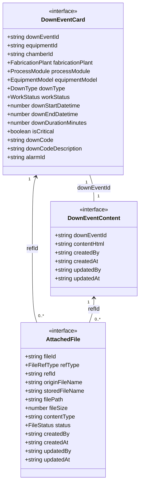
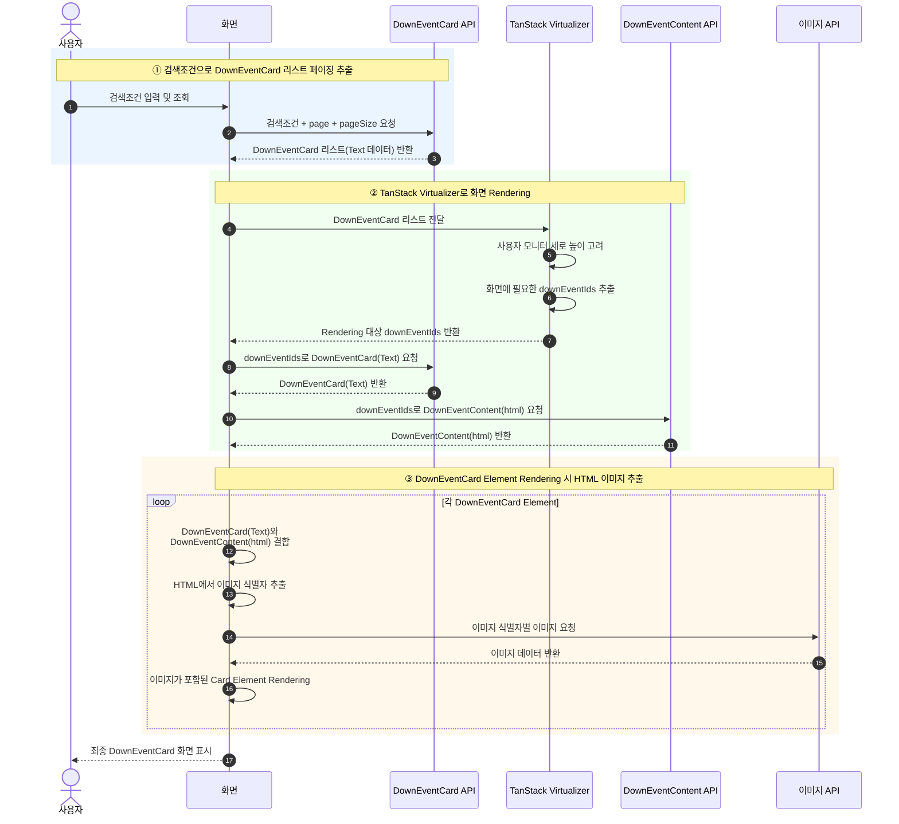

## 1. 주요 도메인 관계 클래스 다이어 그램

* **DownEventCard** : 장비 down 이벤트 이력 ( Text )
* **DownEventContent** : 장비 down 현상 및 조치 상세 내용 ( html )
* **AttachedFile** : html 에 삽입한 이미지파일 정보  

## 2. 주요 처리 흐름도

① 검색조건으로 **`DownEventCard 리스트 페이징`** 추출 (Text 데이터)

② **`TanStack Virtualizer로 화면 Rendering`**
   - 사용자 모니터 세로 높이를 고려한 Rendering 을 위한 **`식별자 downEventIds`** 추출
   - Rendering  대상 downEventIds 로 **`DownEventCard(Text) / DownEventContent(html)추출하는 API`** 호출

③ 각 DownEventCard Element Rendering 시 **`html 의 여러 이미지 추출하는 API`** 호춯 

