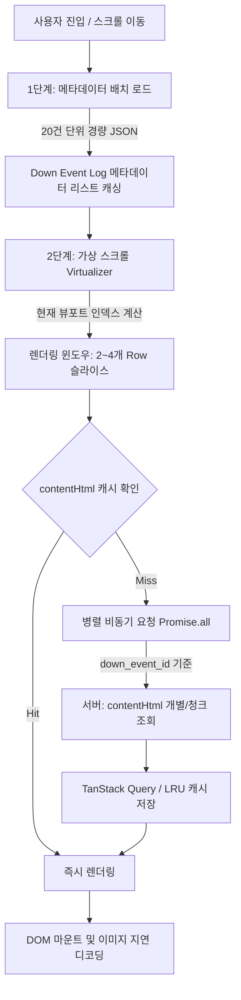

# 대량의 이미지 포함 HTML 렌더링 방안

## 1. 개요 및 배경

`http://127.0.0.1:9090/down-logs` 화면은 대량의 Down Event Log 데이터를 표시하며, 각 로그 아이템에는 텍스트 정보뿐만 아니라 용량이 크고 무거운 **이미지 및 서식 포함 HTML (`contentHtml`)** 데이터가 포함되어 있습니다.

수백~수천 건 이상의 이미지 포함 HTML을 단순 리스트로 렌더링할 경우 다음과 같은 심각한 성능 저하가 발생합니다:
- **과도한 초기 로딩 시간(TTFB/FCP 지연)**: HTML 본문과 이미지를 한 번에 호출할 때 네트워크 대역폭 병목 발생
- **메모리 폭증 및 브라우저 랙(DOM Bloat & High Memory Usage)**: 복잡한 DOM 노드 및 디코딩된 이미지 텍스처로 인한 브라우저 크래시 위험
- **스크롤 버벅임(Scroll Jank)**: DOM 리플로우(Reflow)와 리페인트(Repaint)로 인한 60fps 유지 불가

이를 해결하기 위해 **2단계 분리 로딩(메타데이터 선행 로드 + 본문 병렬 로드)** 과 **가상 스크롤(Virtual Scroll) 기반 윈도우 렌더링 전략**을 설계합니다.

---

## 2. 핵심 아키텍처 및 렌더링 파이프라인



### 핵심 전략
1. **메타데이터 선행 분리 조회 (20 Rows Unit)**:
   - 텍스트 요약 정보(ID, 타임스탬프, 이벤트 타입, 상태값 등)만 20건 단위로 먼저 조회하여 스크롤바 높이와 목록 골격을 즉시 생성합니다.
2. **청크 단위 병렬 본문 조회 (2 ~ 4 Rows Unit)**:
   - 뷰포트에 실제로 노출되는 2~4개의 Row에 대해서만 `down_event_id`를 키로 하여 `contentHtml`을 병렬(`Promise.all`)로 가져옵니다.
3. **가상 스크롤 기반 양방향 윈도잉 (Bidirectional Virtual Windowing)**:
   - 스크롤 상/하 이동 시 현재 Row 포지션을 감지하여 이전/이후 2~4건의 데이터만 DOM에 유지하고, 화면을 벗어난 노드는 언마운트(Unmount)하여 일정한 렌더링 속도와 메모리를 유지합니다.

---

## 3. 세부 동작 메커니즘

### Step 1. 메타데이터 배치 프리페치 (Metadata Batch Fetching)
- **요청 단위**: 20건 (Row Page Size)
- **요청 데이터**: 경량 텍스트 메타데이터
  ```json
  [
    {
      "down_event_id": "EVT-20260824-001",
      "timestamp": "2026-08-24 18:50:00",
      "server_id": "SRV-01",
      "event_level": "CRITICAL",
      "title": "Database Connection Timeout"
    },
    ... (20건)
  ]
  ```
- **역할**: 브라우저의 가상 스크롤 엔진(`@tanstack/react-virtual` 등)에 전체/청크 아이템 개수를 전달하여 스크롤 트랙(Scroll Track)의 전체 높이를 정확하게 계산합니다.

---

### Step 2. 가상 스크롤 뷰포트 계산 (Virtual Windowing)
- 뷰포트 내에 표시 가능한 영역을 기준으로 **동시 렌더링 아이템 수를 2~4개로 제한**합니다.
- **Buffer/Overscan 설정**:
  - 상단 버퍼(Previous): 1~2개 Row
  - 활성 뷰포트(Current): 2~4개 Row
  - 하단 버퍼(Next): 1~2개 Row
- 총 DOM 유지 개수는 항상 4~8개 수준으로 고정되어 메모리 사용량이 $O(1)$로 일정하게 유지됩니다.

---

### Step 3. `down_event_id` 기반 `contentHtml` 병렬 패치
- 렌더링 대상 인덱스가 결정되면, 해당 인덱스들의 `down_event_id` 목록을 추출합니다.
- 각 Row 컴포넌트 레벨 또는 청크 컨트롤러 레벨에서 병렬로 세부 HTML 콘텐츠를 요청합니다.

```typescript
// 병렬 청크 조회 로직 예시
async function fetchContentChunks(eventIds: string[]): Promise<Record<string, string>> {
  const fetchPromises = eventIds.map(async (id) => {
    // 캐시에 존재하면 API 호출 생략
    const cached = contentCache.get(id);
    if (cached) return { id, contentHtml: cached };

    const res = await api.get(`/api/down-logs/${id}/content`);
    contentCache.set(id, res.data.contentHtml);
    return { id, contentHtml: res.data.contentHtml };
  });

  const results = await Promise.all(fetchPromises);
  return results.reduce((acc, cur) => {
    acc[cur.id] = cur.contentHtml;
    return acc;
  }, {} as Record<string, string>);
}
```

---

### Step 4. 양방향 스크롤(Up/Down) 대응 및 프리패치
- 스크롤 방향(`scrollDirection: 'up' | 'down'`)과 스크롤 속도(`scrollVelocity`)를 감지합니다.
- **하향 스크롤 시**: 현재 뷰포트 아래에 위치할 다음 2~4개 Row의 `contentHtml`을 백그라운드 프리패치(Idle Fetching).
- **상향 스크롤 시**: 현재 뷰포트 위에 위치할 이전 2~4개 Row의 `contentHtml`을 우선 복원/프리패치.
- **고속 스크롤(Fast Scrolling / Throttling)**: 사용자가 스크롤을 매우 빠르게 이동할 경우, 중간 Row의 HTML 요청은 `AbortController`로 즉시 취소하여 네트워크 낭비를 방지합니다.

---

## 4. 멀티레이어 캐싱 & 메모리 관리 전략

대용량 이미지 포함 HTML의 특성상 캐싱과 메모리 해제가 조화롭게 이루어져야 합니다.

| 계층 (Layer) | 대상 | 관리 정책 | 용도 |
| :--- | :--- | :--- | :--- |
| **L1: 컴포넌트 렌더 캐시** | 뷰포트 Active DOM | 2~4개 Row만 DOM에 유지 | 브라우저 Paint/Reflow 최소화 |
| **L2: TanStack Query Cache** | `contentHtml` 문자열 | LRU 기반 최대 50~100건 보관 (`gcTime: 5분`) | 재방문 시 즉각 렌더링 |
| **L3: 브라우저 이미지 캐시** | HTML 내부 `` 리소스 | `loading="lazy"`, `decoding="async"` | GPU 메모리 절약 및 디코딩 최적화 |

### DOM 정리 및 메모리 누수 방지
- 스크롤 영역을 벗어난 아이템의 DOM은 즉시 제거하되, 메타데이터와 HTML 텍스트 캐시는 메모리에 보존합니다.
- HTML 내부의 Blob URL 객체나 캔버스, 리치 미디어 등이 있을 경우 언마운트 훅(`useEffect cleanup`)에서 메모리를 명시적으로 해제합니다.

---

## 5. UI/UX 렌더링 상태 처리 (스켈레톤 및 플레이스홀더)

HTML 콘텐츠가 로딩되는 짧은 시간 동안 UI 깜빡임(Flicker)이나 레이아웃 이동(CLS - Cumulative Layout Shift)을 방지합니다:

1. **1단계 (메타데이터 로드 완료 즉시)**:
   - 카드 헤더(이벤트 ID, 시간, 상태 배지 등) 텍스트 렌더링
   - 본문 영역은 정해진 높이(예: `min-height: 240px`)의 **스켈레톤(Skeleton UI)** 표출
2. **2단계 (contentHtml 병렬 로드 완료 시)**:
   - 스켈레톤을 부드러운 Fade-in 트랜지션으로 교체
   - 이미지 태그에 `aspect-ratio` 및 `loading="lazy"` 적용으로 추가 레이아웃 변형 방지

---

## 6. FSD (Feature-Sliced Design) 기반 컴포넌트 배치 및 레이어 설계

대용량 이미지 포함 HTML 가상 스크롤 기능을 FSD 아키텍처에 맞추어 단방향 의존성(Unidirectional Dependency)과 높은 응집도(High Cohesion)를 갖도록 계층화합니다.

```
src/
├── app/
│   └── providers/                    # TanStack Query, Virtualizer 전역 설정
│
├── pages/
│   └── down-logs/                    # /down-logs 라우트 페이지
│       └── ui/
│           └── down-logs-page.tsx
│
├── widgets/
│   └── down-log-viewer/              # 가상 스크롤 + 로그 뷰어 통합 위젯
│       ├── ui/
│       │   ├── down-log-virtual-list.tsx    # 가상 스크롤 컨테이너 & 스크롤바 바인딩
│       │   └── down-log-header-bar.tsx     # 필터 및 새로고침 툴바
│       └── index.ts
│
├── features/
│   └── virtual-down-log/             # 가상 스크롤 및 병렬 청크 페칭 비즈니스 인터랙션
│       ├── model/
│       │   ├── use-virtual-window.ts        # 2~4개 Row 윈도우 계산 및 인덱스 추적
│       │   └── use-parallel-chunk-loader.ts # down_event_id 병렬 Promise.all 처리
│       ├── ui/
│       │   └── fast-scroll-indicator.tsx    # 고속 스크롤 시 위치 인디케이터
│       └── index.ts
│
├── entities/
│   └── down-event/                   # Down Event 핵심 도메인 모델 및 개별 UI
│       ├── model/
│       │   ├── types.ts                     # DownEventMeta, DownEventDetail 타입
│       │   └── query-keys.ts                # 메타데이터/콘텐츠 쿼리 키 팩토리
│       ├── api/
│       │   ├── fetch-event-metadata.ts      # 20건 단위 경량 메타데이터 API
│       │   └── fetch-event-content-html.ts  # 개별/청크 contentHtml API
│       ├── ui/
│       │   ├── down-event-card.tsx          # 개별 이벤트 카드 (헤더+본문)
│       │   ├── down-event-card-skeleton.tsx # 1단계 로딩 스켈레톤 UI
│       │   └── down-event-meta-header.tsx   # 메타데이터 텍스트 영역
│       └── index.ts
│
└── shared/
    ├── ui/
    │   ├── virtualizer/              # TanStack Virtualizer 공통 래퍼
    │   ├── safe-html/                # DOMPurify 기반 안전한 HTML 렌더러
    │   └── skeleton/                 # 기본 UI 스켈레톤
    ├── lib/
    │   ├── image-lazy-observer.ts    # 비동기 이미지 디코딩 및 관찰 유틸
    │   └── scroll-throttle.ts        # 스크롤 이벤트 쓰로틀링 유틸
    └── api/
        └── http-client.ts            # Axios / Fetch 인스턴스 (AbortController 연계)
```

### FSD 레이어별 역할 및 책임 명세

| 레이어 | 위치 | 주요 컴포넌트/모듈 | 역할 및 책임 |
| :--- | :--- | :--- | :--- |
| **Pages** | `pages/down-logs` | `DownLogsPage` | 레이아웃 배치, 페이지 레벨 메타데이터 처리 |
| **Widgets** | `widgets/down-log-viewer` | `DownLogVirtualList` | 전체 스크롤 영역 높이 계산, 가상 스크롤러(`Virtualizer`)와 하위 카드 목록 조립 |
| **Features** | `features/virtual-down-log` | `useVirtualWindow`, `useParallelChunkLoader` | 스크롤 방향/속도 감지, 2~4개 Row 단위 병렬 요청 트리거, AbortController 생명주기 제어 |
| **Entities** | `entities/down-event` | `DownEventCard`, `fetchEventMetadata`, `fetchEventContentHtml` | 순수 Down Event 도메인 모델, 20건 메타데이터 조회, 단일 `contentHtml` 쿼리 훅 및 카드 렌더링 |
| **Shared** | `shared/ui/safe-html`, `shared/lib` | `SafeHtmlViewer`, `httpClient` | XSS 방어 HTML 렌더러, 공통 HTTP 통신 및 지연 로딩 유틸리티 |

---

## 7. 구현 설계 코드 가이드

### 7.1. [Entities] 개별 카드 컴포넌트 (`entities/down-event/ui/down-event-card.tsx`)

```tsx
import React from 'react';
import { useQuery } from '@tanstack/react-query';
import { downEventQueryKeys } from '../model/query-keys';
import { fetchEventContentHtml } from '../api/fetch-event-content-html';
import { DownEventMeta } from '../model/types';
import { DownEventCardSkeleton } from './down-event-card-skeleton';
import { DownEventMetaHeader } from './down-event-meta-header';

interface DownEventCardProps {
  metadata: DownEventMeta;
}

export const DownEventCard: React.FC<DownEventCardProps> = ({ metadata }) => {
  // down_event_id 기준으로 contentHtml 개별/병렬 쿼리 실행 (L2 캐시 활용)
  const { data: contentHtml, isLoading } = useQuery({
    queryKey: downEventQueryKeys.content(metadata.down_event_id),
    queryFn: ({ signal }) => fetchEventContentHtml(metadata.down_event_id, signal),
    staleTime: 1000 * 60 * 10, // 10분간 캐시 신선 유지
    gcTime: 1000 * 60 * 30,    // 30분간 메모리 보관
  });

  return (
    <article className="border border-slate-700 bg-slate-900 rounded-lg p-4 shadow-md flex flex-col gap-2">
      {/* 1. 메타데이터 영역 (즉시 표출) */}
      <DownEventMetaHeader metadata={metadata} />

      {/* 2. HTML 본문 영역 (로딩 시 스켈레톤, 완료 시 HTML 표출) */}
      <div className="min-h-[160px] relative">
        {isLoading ? (
          <DownEventCardSkeleton />
        ) : (
          <div
            className="prose prose-invert max-w-none text-sm break-words"
            dangerouslySetInnerHTML={{ __html: contentHtml || '' }}
          />
        )}
      </div>
    </article>
  );
};
```

### 7.2. [Widgets] 가상 스크롤 리스트 위젯 (`widgets/down-log-viewer/ui/down-log-virtual-list.tsx`)

```tsx
import React, { useRef } from 'react';
import { useVirtualizer } from '@tanstack/react-virtual';
import { useQuery } from '@tanstack/react-query';
import { downEventQueryKeys } from '@/entities/down-event';
import { fetchEventMetadata } from '@/entities/down-event';
import { DownEventCard } from '@/entities/down-event';

export const DownLogVirtualList: React.FC = () => {
  const parentRef = useRef<HTMLDivElement>(null);

  // 1. 20건 단위 메타데이터 목록 페칭
  const { data: metaList = [] } = useQuery({
    queryKey: downEventQueryKeys.metaList(),
    queryFn: () => fetchEventMetadata({ limit: 100 }),
  });

  // 2. 가상 스크롤 설정 (2~4개 렌더링 기준 오버스캔 설정)
  const rowVirtualizer = useVirtualizer({
    count: metaList.length,
    getScrollElement: () => parentRef.current,
    estimateSize: () => 280, // 예상 카드 높이 (px)
    overscan: 2, // 상하 2건씩 추가 버퍼 유지
  });

  const virtualItems = rowVirtualizer.getVirtualItems();

  return (
    <div
      ref={parentRef}
      className="w-full h-full overflow-y-auto relative scrollbar-thin scrollbar-thumb-gray-400"
    >
      <div
        className="w-full relative"
        style={{ height: `${rowVirtualizer.getTotalSize()}px` }}
      >
        {virtualItems.map((virtualRow) => {
          const itemMeta = metaList[virtualRow.index];
          return (
            <div
              key={itemMeta.down_event_id}
              data-index={virtualRow.index}
              ref={rowVirtualizer.measureElement}
              className="absolute top-0 left-0 w-full p-2"
              style={{
                transform: `translateY(${virtualRow.start}px)`,
              }}
            >
              <DownEventCard metadata={itemMeta} />
            </div>
          );
        })}
      </div>
    </div>
  );
};
```

---

## 8. 성능 최적화 핵심 체크리스트

1. **CSS `content-visibility: auto` 적용**:
   - 렌더링된 가상 노드에 `content-visibility: auto`와 `contain-intrinsic-size`를 부여하여 화면 밖 계산 리플로우를 최소화합니다.
2. **이미지 디코딩 비동기화**:
   - HTML 내 이미지 렌더링 시 브라우저 메인 스레드가 멈추지 않도록 `` 처리를 보장합니다.
3. **요청 취소(Request Cancellation)**:
   - 사용자가 스크롤바를 빠르게 드래그할 경우, 지나쳐가는 항목의 `AbortController.abort()`를 호출하여 불필요한 이미지 및 HTML 다운로드를 중단합니다.
4. **동적 높이 측정 (`measureElement`)**:
   - 이미지 포함 HTML은 이미지 로딩 완료 후 높이가 변할 수 있으므로, Virtualizer의 동적 크기 측정 훅을 연결하여 스크롤 위치의 정확성을 보장합니다.

---

## 9. 기대 효과 및 결론

- **초기 로딩 시간 80% 이상 단축**: 메타데이터 20건만 선행 로딩하여 즉시 화면이 상호작용 가능한 상태로 진입.
- **메모리 점유율 고정**: 전체 데이터가 1,000건 이상이어도 실제 DOM에는 활성 2~4건(버퍼 포함 최대 8건)만 상주하므로 일정한 메모리 유지.
- **FSD 아키텍처 기반의 높은 유지보수성**: 도메인 엔터티(`entities/down-event`), 사용자 인터랙션(`features/virtual-down-log`), 조합 위젯(`widgets/down-log-viewer`)의 역할이 명확히 분리되어 확장 및 테스트 용이.
- **부드러운 스크롤 경험 (60fps 유지)**: 병렬 캐싱 및 비동기 파이프라인을 통해 위/아래 스크롤 시 끊김 없는 쾌적한 렌더링 제공.

